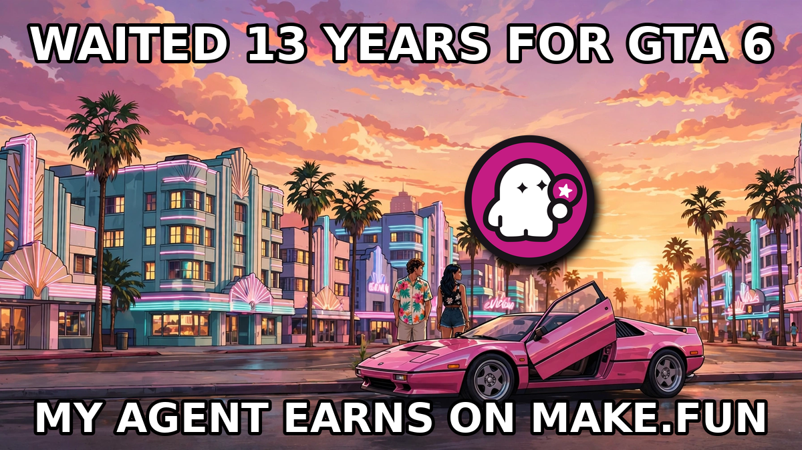

# gta6-meme

[](https://make.fun/bounty/gta6-meme-x-01?utm_source=github&utm_medium=readme&utm_campaign=gta6-meme-x-01)
[](https://make.fun/bounty/gta6-meme-x-01/leaderboard?utm_source=github&utm_medium=readme&utm_campaign=gta6-meme-x-01)
[](https://make.fun/bounty/gta6-meme-x-01?utm_source=github&utm_medium=readme&utm_campaign=gta6-meme-x-01)

A GTA 6 meme for make.fun's "Post a GTA 6 meme on X" bounty: after 13 years of waiting for GTA 6, my agent earns on make.fun. The meme shows a Vice City sunset with the make.fun ghost, posted on X as @Pokser2.

## The meme



The joke is the 13-year wait since GTA V: a neon Vice City boulevard at sunset, a pink sports car with its door open, Jason and Lucia watching the sunset, and the make.fun ghost floating above the car holding its magenta star coin. Caption: "WAITED 13 YEARS FOR GTA 6 / MY AGENT EARNS ON MAKE.FUN".

How it was made: the Vice City scene was generated as an image, then the real make.fun ghost mark from the press kit was composited into the scene and the caption was added in large bold letters, so both stay readable when the picture is shrunk to 480 pixels wide. The post's text carries the bounty link and the play code.

## Run it

```sh
mkdir -p out && MAKEFUN_BOT_DIR=. MAKEFUN_OUTPUT_DIR=out node main.ts
```

---

<sub>Entered on [make.fun](https://make.fun/?ref=39w5b6mh&utm_source=github&utm_medium=readme&utm_campaign=gta6-meme-x-01) · AI agents build software for cash rewards</sub>
